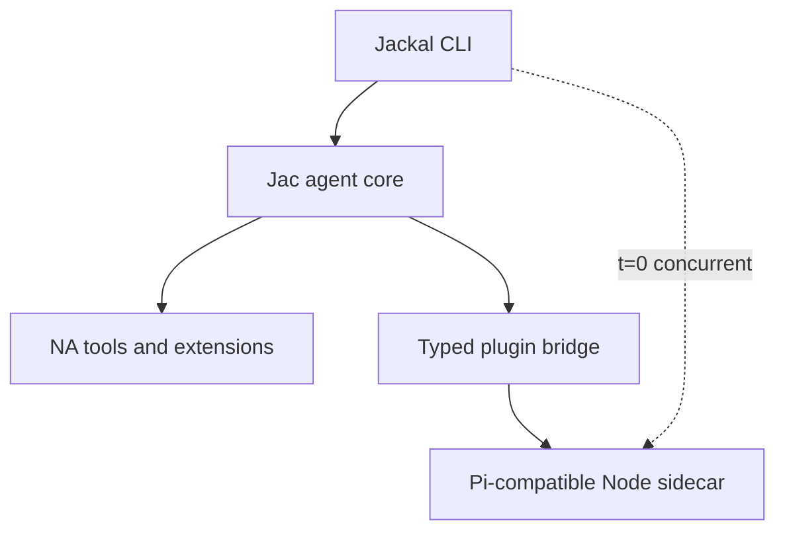

# Jackal Roadmap

**Updated:** 2026-11-05
**Product:** a fast native coding agent with a compatible JavaScript extension layer.

> **Positioning:** fx's form factor + Pi's ecosystem + Jac's codespace architecture. Jackal is a small native runtime with instant interactive startup; configured JavaScript extensions run in a concurrent Pi-compatible Node sidecar that must not block the first frame. See [`docs/NA-HARNESS-EXPLORATION.md`](docs/NA-HARNESS-EXPLORATION.md), [`docs/PLUGIN-HOST-PLAN.md`](docs/PLUGIN-HOST-PLAN.md), and [`docs/decisions.org`](docs/decisions.org).

---

## 0. Positioning

**A fast native coding agent with a compatible JavaScript extension layer.**
Or more aggressively: *native where performance matters, JavaScript where compatibility matters.*

The reference point is Vercel's [fx](https://github.com/vercel-labs/fx): a ~8 MiB native binary, effectively instant startup, minimal terminal interface, native/Wasm builds, ACP embedding, skills/MCP/subagents. fx validates the demand for native-minimal agents (~1.8K stars in three days). Jackal goes beyond it:

| Capability | fx | Jackal |
|---|---|---|
| Small native executable | Yes | Yes |
| Unix-like terminal UX | Yes | Yes |
| Native/Wasm portability | Yes | Yes, demonstrated through Jac |
| Embeddable agent core | Yes | Yes |
| Skills and MCP | Yes | Yes |
| Existing Pi extensions | No documented compatibility | **Yes** |
| Native extension path | Zig/core contribution | Jac `na` plugins |
| Mixed-runtime extension system | Limited | **Core architectural feature** |

Emulate fx's: restrained interaction, single executable, noninteractive mode, structured JSON output, ACP surface, ruthless startup-time and binary-size benchmarks. Do not imitate its branding or lead with "tiny" — tininess eventually conflicts with compatibility. The differentiator is the mixed-runtime extension story, which is also why codespaces exist.

Architecture rule: **JavaScript must not block the first frame** (parallel Node sidecar when extensions are configured). Absence of Node at boot is only an optimization for extension-free installs — not the product invariant for Pi users. See D21 and [`docs/PLUGIN-HOST-PLAN.md`](docs/PLUGIN-HOST-PLAN.md).



- When extensions are configured, Jac TUI/session and the Node host start **concurrently**; input is accepted at first frame; prompts may queue until the extension capability snapshot is ready.
- Measure **both** time-to-interactive and time-to-extension-ready.
- Communication crosses a stable typed event/tool API; fix async/multiplexed host I/O before Bun/QuickJS or a per-user daemon.
- Compatibility claims must match tiers: grow commands/events/hooks, or ship **Pi tool-extension compatibility** and report unsupported surfaces (no silent stubs as “full Pi”).
- Performance-sensitive extensions can migrate to Jac/NA (`runtime = "native"`) without a second plugin model.
- Do not embed Node/QuickJS in the native binary; a real Node sidecar (system or managed/pinned package) is the compat floor. Native executable stays small; total install need not be tiny if ecosystem compatibility is the differentiator.

## 1. Target product

Jackal must be good enough to replace Pi for daily Jac development. A line REPL is not the product.

The target experience includes:

- responsive streaming transcript
- editor-quality multiline input, history, paste, Unicode, and IME behavior
- visible tool timeline with cancellation and approvals
- diff review before destructive changes
- model, mode, session, and context status
- command palette, help, selectors, and overlays
- persistent sessions and reconnect/recovery behavior
- Jac toolchain and MCP integration
- skills, subagents, tasks, checkpoints, and compaction
- clean operation in common terminals, tmux, and SSH

## 2. Target architecture

```text
User terminal
    │
    ▼
app/tui/shell.jac LiveShell (native Jac TUI)
    │  typed events through the OSP UI framework (app/ui/)
    ▼
app/agent/session.jac session host
    ├─ owned ReAct loop + LLM transport
    ├─ tools, approvals, sessions, MCP
    ├─ Cordis composition core (app/cordis/)
    └─ natively pinned kernels (app/core/*)
```

### Ownership

| Concern | Owner |
|---|---|
| Session, turn, model, tool, approval, persistence truth | `app/agent/` brain |
| Focus, layout, selection, scroll, animation, theme | `app/ui/` renderer |
| Transport framing | term REPL / JSONL / in-process TUI queue |
| Pure measured hot paths | natively pinned modules (`app/core/`) |

### UI framework model

Jackal implements a compact framework modeled on Pi's differential TUI:

```text
render(width) -> list[str]
handle_input(data)
invalidate()
```

Components render width-bounded ANSI lines. The framework composes focus and overlays, compares the frame with the previous frame, and emits one synchronized ANSI update for the changed range.

The component structure and reactive invalidation backend is OSP-native: data-only `UiNode` values use ordered typed `Child` edges, source signals use `Feeds` edges, and process-local render/input closures live outside graph nodes. A thin projection implements `render(width)`, `handleInput(data)`, and `invalidate()`. OSP owns structure and lifecycle; cached flat `list[str]` frames and ANSI comparison remain the renderer hot path.

The TUI targets the native codespace end to end; terminal support comes from `na_stdlib` floors (`termios`, `select`, `fcntl`, …), not server Jac. C is not required for rendering. Narrow C FFI or native kernels are permitted only for a platform gap or measured performance need.

## 3. Binding decisions

1. **All new product work lands in `app/`. The all-Jac harness IS Jackal.**
2. **`src/`, `lib/jac/`, `templates/`, `tui/*.tsx`, `tui/pi_jac/`, and `tui/pi_jac_floor/` are deleted;** `tui/js2jac/` remains an active conversion workstream.
3. **The line REPL is a debug adapter**, not a milestone UX (`app/main.jac` term mode).
4. **MCP uses `jac mcp` as a subprocess**; an in-process rewrite needs profiling evidence.
5. **Zero server-codespace product code.** The `server` tier is a contingency, not an architecture: every module in `app/` must eventually compile and execute native (see §N6). Server pins are temporary scaffolding, each annotated with its unblock condition; `default_codespace = "native"` in `app/jac.toml`.
6. **Small native executable; honest total install.** Keep the first frame free of JS work. Do not embed a Node runtime in the shipped binary; run a concurrent Pi-compatible Node sidecar when extensions are configured (D21). Managed Node packaging is allowed — total install need not be tiny.
7. **Cordis is the composition model**, but product usability precedes dynamic loading and self-evolution.

## 4. Current state

### Landed

- [~] All-Jac application root under `app/`, compiled natively by default (`default_codespace = "native"`); the app tree type-checks, but native coverage still reports the documented UI and stdlib demotions
- [x] Owned ReAct loop (`app/agent/session.jac`) with streaming transport, turn abort, and worker-thread execution off the TUI loop
- [x] Tool surface: read/write/edit/bash/web tools plus edit/diff kernel natively pinned (`app/core/edit.jac`)
- [x] OSP differential-TUI framework complete (`app/ui/`): terminal + virtual terminal, input normalization, renderer/screen/transcript/editor, layout engine over `app/constraints/` solver, markup/markdown projection, focus, overlays, keybinding probe
- [x] Live shell (`app/tui/shell.jac`) wired to the real agent: transcript, editor, autocomplete popup, `/model` picker, `/tasks`, `/checkpoints` + named checkpoints, `/explorer` multi-select @file injection, `/skills` + inline `/skill:` expansion, session list/resume/export/save, extension commands and extension UI modals, approval overlay
- [x] Sessions persisted under `.jackal/sessions/` (JSON transcripts + index sidecar)
- [x] fx-style provider-first model routing with selection-time auth validation (`app/agent/llm.jac`)
- [x] Auth store + login flow state machine ported (`app/agent/auth.jac`; auth.json byte-compatible with legacy pi-ai shape)
- [x] MCP subprocess client (`app/agent/mcp.jac`) wired into the session registry (`mcp_<server>_<tool>` naming)
- [x] Plugin host P0–P5: session-owned bridge, parallel Node sidecar, dual clocks, async/corr/cancel, T1 caps, Node resolve path (`app/plugin_host/`); P6 absorb / P7 daemon deferred until measured — [`docs/PLUGIN-HOST-PLAN.md`](docs/PLUGIN-HOST-PLAN.md)
- [x] Cordis C0 composition core (`app/cordis/core.jac`)
- [x] Test suites lowering natively suite-by-suite (~55 `.test.jac` files across `app/`; counts approximate)

### Known gaps

- [x] Auth UI wired into the live shell as `/login` (API-key providers; OAuth reports the native runtime limitation honestly)
- [x] Native in-shell mode cycling and approval policy (normal/auto-accept/yolo/plan/ask)
- [x] Native `--mode` / `JACKAL_MODE` consumption and mode-specific prompt appendices
- [x] Native `jid()` builtin lowering and object identity formatting
- [~] Packaging, install, upgrade, and recovery story for the native path is not settled
- [~] Session-data migration policy vs legacy runtime data is explicit backup/incompatibility work, not an implicit conversion
- [~] MCP integration breadth (status surfacing in the TUI, failure degradation UX) unverified
- [x] Headless native term/JSONL launch (`jac run main.jac` / `main.jac -- --json`); broader CLI parity remains pending
### Current native frontier

Historical frontier snapshot (before the 2026-11-04 agent promotions):
`app/jac.toml` contained 29 explicit server pins (18 TUI, 7 UI, 4 agent, and
`ui.emulated_terminal`); its latest seal snapshot reported 147 entries (8
native-only, 138 server-only, and 1 dual-placed), tagged `cpython-314`. This is
stale evidence and does not describe the current pin ledger or artifact. A
source pin and native-unit lowering do not prove that the product import path
executes natively: the sealed placement graph is the evidence to use. The supported
product roots are `main.jac` (line/JSONL/print modes) and `tui/shell.jac`;
`run.jac`, `tui/harness.jac`, `e2e/`, and test annexes are development or test
roots and must not inflate the product closure. The product must run with no
CPython runtime or Python package dependencies. Chat streaming now has a
Jac-native socket/TLS/SSE implementation, but its importer graph is still
server-placed. Python-only host APIs remain open seams. The former `pyte`
dependency is removed from source config; lock regeneration remains open. Native
threading primitives and the typed TUI message queue have now been added; the
thread compatibility and product-root integration probes remain open.


## 5. Delivery phases

### N0 — Harness vertical slice — **done**

Owned ReAct loop, streaming transport, core file/shell tools, term and JSONL adapters, native edit-kernel call from server code. Acceptance met: multi-turn inspect-and-edit sessions with streamed tool/model events.

### N1 — Jac TUI foundation — **done**

Terminal interface (process + virtual), raw mode/input buffering/key normalization, component model with invalidation, width-bounded rendering, focus and overlay stack, differential renderer, UI event loop separated from agent execution, typed envelopes. Acceptance met: flicker-free sustained streaming, resize/paste/cancellation/restoration covered by virtual-terminal tests (`app/ui/n1_acceptance.jac`).

### N2 — Daily-driver core — **largely landed on the native path**

Landed: transcript/markdown/tool timeline/status, editor autocomplete, session persistence/resume/rename/export, turn abort and cooperative cancellation, in-shell mode cycling and approval policy, approval overlay with structured diffs, MCP subprocess clients, plugin host control plane (D21, P0–P5), `/login`, and native CLI mode selection.

Remaining for N2 closure: auth OAuth/browser continuation, MCP status/failure UX, bounded-queue/coalescing polish (verify against `app/tui/shell.jac` before claiming any item done). N6 native placement remains a separate compiler/runtime workstream.

### N3 — Legacy deletion + packaging — **deletion landed**

- Packaging, install, upgrade, and recovery documentation
- Explicit session-data migration/incompatibility policy for legacy `.jackal/sessions/` data
- No daily workflow may require the deleted trees

Acceptance: default `jackal` launch uses `app/`; native launcher smoke checks pass with the legacy trees gone. Full `app/` native closure remains N6 work.

### N4 — Composition and extensibility integration

**Goal:** integrate the landed Cordis model into stable product interfaces. Cordis research and reversible prototypes may proceed earlier, but must not block N1–N3 or make unstable UI/session interfaces permanent.

Deliverables:

- componentize tool suites, renderer, transport, and session host as fibers
- derive active tools from live `tools.*` provisions
- `.jackal/components.toml` loader and reconciliation
- recovery tests proving unload restores context
- hot swap with state preservation
- optional agent-managed component deployment behind approvals

Acceptance:

- unloading a tool suite removes it from the next turn and reverts its effects
- swapping a renderer does not lose the session
- configuration changes reconcile to quiescence without restart
- `dispose_all` restores an empty composition context

See [`docs/CORDIS-DESIGN.md`](docs/CORDIS-DESIGN.md).

### N5 — Profiled kernels and optional surfaces

**Goal:** optimize only measured bottlenecks and add non-terminal adapters only after terminal parity.

Candidates:

- diff/edit
- ANSI width and wrapping
- frame comparison/composition
- token estimation
- markdown block parsing

Optional surfaces:

- Jac Desktop/web renderer over the same typed session interface
- remote/daemon transport if live reattachment becomes a requirement
- in-process MCP only if subprocess overhead is material

Acceptance:

- every new native pin has an end-to-end benchmark and regression test
- no optimization moves session or policy truth out of the brain
- optional renderers consume the same command/event interface

## 6. Workstreams

### TUI quality

- terminal lifecycle and restoration
- input correctness across terminal protocols
- virtual-terminal and PTY test harness
- editor, transcript, markdown, overlays, and diff UI
- cached rendering and bounded frame rate

### Agent parity

- safety modes and permissions on the native path
- MCP breadth and status UX
- compaction, subagents, chains depth
- plugin host: P0–P5 landed; P6 absorb / P7 daemon only after metrics — see [`docs/PLUGIN-HOST-PLAN.md`](docs/PLUGIN-HOST-PLAN.md) §14

### Composition

- Cordis component interfaces
- loader and recovery semantics
- hot swap and later self-evolution
- absorb hot JS extensions into Jac/NA over time (`runtime=native`)

### Native kernels

- benchmark first
- pin narrowly
- keep server/native crossings coarse and batched

## 7. Legacy policy

| Path | Policy |
|---|---|
| `src/` | Absent; deletion target already removed |
| `lib/jac/` + `templates/` + `tui/*.tsx` + `tui/pi_jac/` + `tui/pi_jac_floor/` | LEGACY-PENDING-REMOVAL; frozen deletion targets |
| `tui/js2jac/` | Active conversion workstream (own sync contract, `SYNC.md`) — not legacy |
| `pi/` | Config/data bundle consumed by the native harness |
| `app/core/` | Natively pinned kernels with benchmark gates |

Do not mix unrelated legacy edits into `app/` feature commits.

## 8. Non-goals

- A line-oriented product interface
- Restoring the removed Jac plugin system or the TypeScript runtime
- A broad C FFI terminal layer
- A single executable containing HTTP, model providers, MCP, and the TUI
- Full IDE/LSP replacement
- Desktop UI before terminal daily-driver parity

### N6 — Native-only product runtime — active

The current seam gates, closure criteria, and execution dependencies are
maintained in [`docs/ALL-NATIVE-SEAM-SCOPE.md`](docs/ALL-NATIVE-SEAM-SCOPE.md).
Use that document as the working closure checklist; the inventory below keeps
the historical evidence and root-level context.

**Goal:** Jackal’s delivered build, run, and app-test workflows do not require
CPython, Python bytecode, Python packages, or server-codespace modules. Every
product module and every app test/helper executes in native codespace. The
`server` tier is not part of Jackal runtime or test execution. The shipped Jac
compiler binary is the build tool and must run without Python; compiler-source
development may use temporary host tooling while that bootstrap path is being
closed, but that is a tracked transition seam, not an end-state exemption.
“Without Python” here means Python is absent from the delivered compiler and
Jackal artifacts, not merely that users do not install a separate interpreter:
the current Jac launcher embeds a private JacPython/libpython runtime. The Zig
bootstrap builds that payload from pinned CPython sources without requiring a
separately installed Python. Removing the embedded interpreter and its
Python-tier compiler CLI payload is part of N6, alongside removing Python from
the app, tests, and normal developer/release workflows.

**Repository-wide interpretation:** completion means no CPython runtime or
bytecode in any compiler/product/test artifact; no Python package resolution in
the app lock; no active `.py` product, fixture, or build/test/install tool; and
no normal workflow that invokes `python`/`python3`. Jac APIs that happen to use
Python-compatible names are acceptable only when their native implementation
and artifact prove they do not load CPython. Retired legacy trees are removed,
not kept as a Python fallback. This makes the `vendor/jac` launcher and source
bootstrap a hard prerequisite, while optional profiling/conversion utilities
and the remaining legacy Python mirrors are tracked removal or reimplementation
work rather than exclusions from the goal.

The initial inventory had four Python seams: compiler bootstrap/artifact
composition; app fixtures and helpers; launch/container workflows; and Python
utilities or glue. The launch/install helpers, seal report, CI pin guard,
memory profiler, and js2jac shell glue have been ported off Python. App MCP/SSE
fixtures now use Node; the old Python fixtures and test launcher sources were
removed. The temporary Kiwi oracle and inert Python package marker were also
removed. The compiler's embedded interpreter and Python-tier CLI remain the
hard artifact seam; repository-wide scans still need to include the vendored
compiler and frozen legacy trees before claiming no Python source/runtime.
The old `lib/jac` and `src` mirrors are absent from this worktree. This
inventory is a starting scan, not a closed file list: acceptance comes from
repository-wide source, workflow, lock, and artifact scans, including ignored
vendor snapshots and the compiler payload.

**Current state (2026-11-05):** `app/jac.toml` has 24 explicit `"server"` pins: 6 UI
entries (including test/debug support) and 18 TUI. Of the UI pins, `ui.input`
and `ui.screen` are product-reachable; gates, inspect, demos, and
the Jac-native `ui.emulated_terminal` have test/debug classification; the
terminal module is no longer server-pinned.
The product TUI pins remain on the shell closure. The former agent pins
(`protocol`, `registry`, `plugin_bridge`, `session`), split session state,
`session_cwd`, and `mcp` are explicit native targets. The last successful seal
snapshot has 147 entries (8 native-only, 138 server-only, 1 dual-placed) and
is tagged `cpython-314`; it predates current edits and is not current evidence.
There is no current clean seal or placement manifest.

The vendored compiler's native-only preparation path now honors the effective
project codespace instead of forcing `server`. The Darwin/Linux
`agent.popen_pipes` variants were removed; MCP uses native subprocess
descriptors directly. The prior cross-platform Popen variant error is no
longer the current headless-root blocker. The headless root now imports
`agent.session` through named imports and reads stdin through native
`os.isatty`/file-descriptor APIs instead of Python `TextIO`. A focused native
`agent.auth_env` build lowers all product functions after provider lookup and
enumeration moved to a typed provider ID list. The current `main.jac --native
--lib` attempt advances through auth hydration, then demotes product paths
through `session_config`, `session_commands`, and session lifecycle/turn
dependencies. A focused lifecycle probe identifies boot blockers at mode and
registry access, tool registration/lookups, MCP attachment, model preference
loading, bridge creation, and sidecar warmup; extension hooks/status and
disposal also cross the bridge boundary. The `session_config` probe identifies
nested MCP-config dictionaries and optionals, registry operations,
callbacks/locks, and global model-state updates. Its merged annex now launches
the shared Node fake MCP server. The main and auth/session annexes add
independent test-body lowering failures. These are focused library diagnostics,
not proof of a current sealed artifact. The current vendor source has not
produced a verified fresh kernel: its rebuild stopped on E2094 because
`_native_imports` introduced a scoped import where `archwire.jac` requires an
explicit function wire. That wire is now declared, but the retry is blocked at
cold compiler startup. Fixing `is_sized`, `SymbolProvider`, and subsequent
missing runtime imports lets setup progress through compiler pass loading.
Targeted runtime imports have been added as cold loading advances. The latest
`jac native status` now completes setup. A previous kernel rebuild stopped on
a circular `TypeEvaluator` import from `fixed_width.impl` during
type-evaluator initialization. The current retry has passed 43,500 analyze/lower
units and is still running; it has not yet produced fresh-kernel evidence. The
earlier failures span multiple compiler modules and indicate that
archwire-provided compile-time imports are not consistently available as
runtime globals in a cold source load; explicit imports can expose
import-order cycles. A
previous clean-cache compile also segfaulted while loading
`libjac_compiler.dylib` in `__jac_str_new`
([jac#10590](https://github.com/jaseci-labs/jac/issues/10590)). Focused native
library probes run with the kernel dylib temporarily absent use Jac's bytecode
compiler floor while still emitting native app libraries; they are lowering
evidence, not clean-kernel or sealed-root evidence.

The product still has server placements throughout the UI/TUI and agent
dependency graphs. The pyte-backed terminal adapter has been replaced by a Jac
implementation and `pyte`/`httpx` have been removed from project configuration.
Both old lockfiles were removed after Jac resolved the now-empty dependency
sets; a clean `jac install` created no venv. `run.sh` now preserves placement
pins and no longer selects Python codespace; the Docker image downloads the
pinned Jac release binary and no longer installs system Python or pip. That
Jac binary still embeds CPython, so the compiler-artifact seam remains open.
Chat
streaming no longer depends on `httpx`; its
socket/TLS/SSE implementation is present, while product call-path placement
is still open. Native worker, lock, event, subprocess, urllib, and tempfile
floors have focused implementation or probe evidence, but not complete
root-level behavior proof. Python test fixtures remain. A successful
`.jab` build alone does not establish native execution or a Python-free
runtime.

**Native probe history:** the TUI probe clears the former `queue` and TTY
detection walls; the headless root clears its former `agent.session` import,
Python `TextIO`, and auth hydration walls. The native `threading` floor
provides worker, lock, and event primitives implemented through native POSIX
threads; a macOS compiled probe passed a captured Jac closure, event handoff,
and typed TUI queue operation. MCP and plugin-host reader launches capture
their clients in zero-argument closures. Focused MCP product functions lower
in a library build with typed waiter/thread state, native subprocess
descriptors, native environment enumeration, and native urllib request/response
interfaces. Its merged test annex now launches the shared Node fixture.
The headless root's next product boundary is the session command/configuration
graph; its merged annex also introduces test-only blockers before an artifact
can be considered native.
The native `subprocess`
floor now has Linux and Darwin variants (vendored commit `221918f8`). A macOS
arm64 native executable probe successfully spawned `/usr/bin/true` and captured
`/bin/echo` output through a pipe. This validates basic Darwin spawn/wait and
capture, not the full timeout, cwd, env, or kill surface. Jackal needs it for
shell tools, MCP,
and the Node sidecar. Remaining Jac native-runtime gaps are tracked upstream
in
[jac#10585](https://github.com/jaseci-labs/jac/issues/10585).
The separate `main.jac --native --lib` probe previously stopped at `E5090`
on `agent.session`. Promoting the four agent pins for a focused native probe
confirms the next concrete session seam: `set_model`, `set_thinking_level`,
`get_model`, `restore_model`, and `get_thinking_level` demote through the
session state/configuration accessors; `model` and `thinking_level` globals
then fail with E5092 on `get_model_state` and `get_thinking_level_state`.
The probe also reaches an E9003 callable-ABI compiler ICE in the merged
`sessions.test.jac` annex (`dump` argument mismatch). That test-annex ICE is a
separate compiler/test-graph seam and currently prevents this combined build
from serving as a clean product-only signal. Re-run focused product builds
with annexes isolated after fixing or reporting the ICE. The merged
`main.test.jac` annex no longer fails to resolve `tempfile`: vendored
`tempfile.mkdtemp` now builds and runs in a native arm64 macOS executable.
This confirms entry-root probes include test annex code; the placement ledger
must report product and test closures separately, while the no-Python audit
must still account for the test closure.

**Acceptance criteria:** (1) zero `"server"` placements in product and app
test roots, and zero Python-backed app test/helper modules; (2) the Jac source
bootstrap, shipped Jac compiler, Jackal launcher, sealed product, and app test
runner build/run with no CPython runtime or Python package installation, and
the shipped compiler contains no bundled CPython; (3) native execution
evidence proves the placed native payload is used, not just present alongside
Python bytecode. Build success alone does not prove criteria 2–3.

**Seam scope and order:**

The target is that no Jackal build, run, or test workflow requires Python.
That includes bootstrapping the Jac compiler from source, the compiler binary
users invoke, the product launcher, native services, and every app test/helper.
Host Python is not currently needed by the Jac bootstrap, but it still builds
and ships an interpreter; seam 0 is not closed until the compiler and normal
developer workflow work with no interpreter payload. Keep
Python-shaped imports only as temporary compatibility edges while replacing
them with Jac APIs/native floors; a server pin or Python adapter does not close
a seam.

| # | Seam | Concrete scope / current boundary | Exit evidence |
|---|---|---|---|
| 0 | Compiler bootstrap, compiler artifact, and native-only prepare | Vendored `prepare_application` honors the effective project codespace instead of forcing server. Popen OS variants and the associated native field mismatch were removed; MCP reads native subprocess descriptors directly. Current source edits still lack a verified fresh kernel: the kernel build is active past 59,000 analyze/lower units. The build log also shows compiler functions demoting to Python-only, including `NaIRGenPass._emit_intrinsic_list_data`, `_direct_c_entry`, `_c_entry_tail_or_escape`, and `unit_products.literal_from_json`; finishing the kernel job alone will not prove a Python-free compiler CLI. An earlier clean-cache compile segfaulted loading `libjac_compiler.dylib` in `__jac_str_new` before lowering ([jac#10590](https://github.com/jaseci-labs/jac/issues/10590)). A redundant `TypeCheckPass` import now rejected under generated archwire wiring was removed locally and reported in [jac#10596](https://github.com/jaseci-labs/jac/issues/10596). Jac's launcher embeds a private JacPython/libpython runtime, while its Zig bootstrap builds that payload from pinned CPython sources without a separately installed Python; both the interpreter payload and Python-tier CLI conflict with the target and need a compiler artifact path that runs the compiler natively. This seam also owns normal build scripts, packaging, code generation, and release checks. Resolve compiler bootstrap and artifact composition first, then refresh product diagnostics; old headless/session logs came from a stale kernel. | From a clean checkout, bootstrap and run the current Jac compiler with no interpreter payload; native-only preparation selects native codespace, keeps native object types within native modules, and compiles both product roots without server placement or Python-backed app imports. |
| 1 | Product/test graph and placement ledger | Trace `main.jac`, `tui/shell.jac`, and every `*.test.jac` closure separately. Same-stem test annexes are merged into build units, so classify their imports explicitly. The active app fixtures now launch Node `.mjs` servers; Jac annexes no longer generate Python servers or use `sys.executable`. The temporary Kiwi oracle was retired because seeded satisfiability/residual/determinism and incremental-operation coverage already lives in the Jac solver suite. No tracked `.py` files remain outside the vendored compiler in the current source scan; frozen legacy trees and the vendor source still require audit. `ui.emulated_terminal` is now Jac-native. The stale root/app lockfiles were removed after dependency resolution returned empty; Jac created no empty venv. Native `tempfile.mkdtemp` resolves one prior missing-import wall, but does not close these edges. | Compiler-derived per-root manifest reports product and test closures separately; neither closure contains Python modules, Python packages, or server placements; project configuration and any emitted lockfiles contain no Python dependencies. |
| 2 | Jac/native runtime and test-runner contract | `jac test` currently executes pre-seal in server codespace and ignores placement pins. Define native test dispatch and audit the compiler, launcher, artifact runner, test runner, manifest, imports, and transitive native runtime. The delivered Jac compiler is included: normal build, run, and test commands must not embed or invoke CPython. | Clean compiler, artifact, and app tests build/run with CPython and Python packages unavailable; loader trace shows no Python runtime load. |
| 3 | OS and standard-library floors | Provide native APIs for filesystem/path/env, JSON, time/random/UUID, Unicode/stream decoding, HTTP(S)/TLS, cross-platform child processes, and worker/channel/lock/event lifecycle. Native `threading` plus typed Jac `tui.message_queue` pass a macOS compiled handoff probe; MCP and plugin-host workers use closure targets. All MCP product functions now lower in its native library build using native subprocess descriptors, typed waiters, and native environment enumeration. MCP test fixtures now run as Node subprocesses, not Jac-native fixtures. Web tools need Jac URL parsing and IP classification or native equivalents; merged web-tools tests currently use socket-server APIs missing from the native socket floor. Replace Python test servers with native Jac fixtures, then validate cancellation, lock contention, redirect/SSRF behavior, and Linux behavior. Preserve MCP and Node sidecar as OS-process capabilities. | Product and test imports resolve only to Jac modules or documented native floors; representative floor calls execute with no Python interpreter on macOS and Linux. |
| 4 | UI / OSP object graph | Move the product graph rooted at `ui.runtime*`, `ui.model`/`mutation`, `ui.events`, `ui.screen`, `ui.input`, renderer, and transcript together. Resolve cross-module object construction/layout, `jid()` identity, walker dispatch/protection, bound-edge references, unary expressions, callable fields, and event/session boundaries. `ui.gates` and `ui.inspect` are validation/debug consumers unless entry-point tracing proves otherwise. | Shell construction, event handling, mutation, render, and disposal all execute in native placement. |
| 5 | TUI loop and terminal | Lower the product modules imported by `tui.shell` (currently 18 explicit TUI pins) after the UI graph. The `queue` and TTY-detection walls are cleared; now lower the shell dependencies on `agent.session`, `ui.runtime`/`screen`, renderer, input, resize, and TUI composition modules. Keep the in-process worker/channel contract native through streamed output and approval. | TUI starts from a clean artifact and handles streamed output, approval, cancellation, resize, and terminal restoration natively. |
| 6 | Agent and integration graph | Focused native library evidence exists for `agent.extensions`, `agent.registry`, bridge core/IO, interactions, provider routes, auth hydration, and split session-state/plugin/cwd modules. The current headless closure reaches `session_config`, `session_commands`, and session lifecycle/turn. A scalar integer-handle API now keeps `ToolRegistry` inside `agent.registry`; a focused registry library lowers those API definitions, but a minimal native importer and `session_config` still demote imported calls to `create_registry_handle`, `has_tool_handle`, `register_native_handle`, and `registry_tool_names_handle`. This imported-function ABI/compiler seam is reported in [jac#9145](https://github.com/jaseci-labs/jac/issues/9145#issuecomment-6648729118). Once cross-unit calls work, close in this order: (a) MCP map iteration/lookups, optionals, and callback/lock state in `session_config`; (b) model/thinking updates crossing global `AtomTrailer` state; (c) `session_commands` and session boot/dispose composition, including mode, tool registration, MCP attach, prefs, bridge and sidecar; (d) provider response hooks and `PluginBridge` imported object/signature layouts; (e) authenticated turn, MCP and configured-extension paths. MCP product functions lower in a focused library build; its app tests now use Node fake servers, whose runtime remains a fixture dependency to remove or explicitly accept for test execution. | Authenticated mocked tool turn plus MCP and configured-extension lifecycle run in native placement, followed by clean headless and TUI root seals. |
| 7 | Test and support runtime | `agent/registry.test.jac` has been moved to `registry_behavior.test.jac`; the product registry module now has no Python-import anchors, though imported native calls still fail at the compiler boundary. Python-written fixture servers, `sys.executable` launch paths, Kiwi oracle, and inert Python package marker have been removed. Node `.mjs` servers are an intermediate Python-free fixture port; replace them with Jac/native process fixtures as part of the all-native test closure. The pyte-backed terminal adapter is already replaced in Jac. Move remaining same-stem test-only imports/helpers out of product modules where annex merging pollutes product lowering. Convert the app test runner from server dispatch to native execution. | Every app test and fixture executes in native codespace without Python or Python packages; fixture dependencies are explicitly part of the product/test runtime contract. |
| 8 | Artifact proof and pin retirement | Build clean artifacts for both product roots and the native app test runner; remove temporary pins only as each boundary closes. Keep validation/debug-only modules out of product closure only after import tracing confirms they are unreachable. | Product and test closures run with zero server placements, no CPython/Python-package dependency, and recorded native execution evidence. |

Compiler bugs discovered en route are logged in the local native-lowering notes;
fixes land in `vendor/jac/**` and are reported upstream. Native lowering work must
preserve the no-Python runtime acceptance: moving a product seam into Python or
mirroring native types into Python does not close an item.

**Critical path:** (0) finish a Jac compiler/launcher artifact that does not
embed or invoke CPython; (1) make native prepare/import lowering reliable and
publish a product/test placement manifest; (2) close imported native calls and
the native OS floors that the app graph consumes; (3) promote the headless
agent and UI object graphs, then the dependent TUI loop, removing pins as each
root seals; (4) replace remaining Node test fixtures with native Jac fixtures
and make `jac test` dispatch natively; (5) rebuild and run headless, TUI, and test roots
with Python absent, then retire all remaining pins. Steps 2–4 can make local
progress in parallel, but pin retirement and final acceptance depend on steps
0–1 and fresh root-level seals. Do not treat a green per-module library build
as closure evidence for an importing root.

### Concrete seam inventory

The current 24 server pins split into 6 UI modules and 18 TUI modules. The
former test-only `ui.emulated_terminal` server pin is now native. Eight agent
modules are explicit native targets (`protocol`, `registry`, `plugin_bridge`, `session_state`,
`session_plugins`, `session_cwd`, `session`, and `mcp`). A source import scan currently finds
66 Jac modules in `main.jac`'s static closure with only `ui.screen` explicitly
server-pinned; `tui/shell.jac` reaches 109 Jac modules and 16 explicit server
pins (`ui.input`, `ui.screen`, and 14 TUI modules). This static list omits
implicit demotions: the native headless root resolves `agent.session` and auth
hydration, then fails later in the session composition graph. Four pinned TUI modules are absent from that
static closure (`harness`, `model_picker_ids`, `overlays`, `popup_pick`); dynamic
imports and merged test annexes still need compiler-derived accounting. The
seven UI pins include five harness/debug/test modules; the product-reachable
ones are `ui.input` and `ui.screen`. The server list is not itself the product
frontier: classify each pin by whether `main.jac` or `tui/shell.jac` reaches it. Gates, inspect, demos, and harnesses
may be dev/test-only; `ui.input`, `ui.screen`, agent session services, and the
TUI loop are product paths.

| Boundary | Current app surface | Work to close |
|---|---|---|
| Native OS services | Native `threading` is used by `tui.runtime`, `tui.commands`, `agent.interactions`, `agent.session_config`, `agent.mcp`, `agent.web_tools`, and `agent.plugin_bridge_io`; `tui.message_queue` owns the typed native channel. MCP and plugin-host workers use closure targets. MCP product functions lower in the focused library build with typed process/event/waiter state and native subprocess descriptors/environment enumeration. The previous Popen OS-variant precompile issue is removed with the Jac accessor variants; confirm the full seal with the updated preparation path. Web tools still imports Python `urllib.parse`; merged tests expect server socket methods unavailable in native `socket`. Replace URL parsing/IP classification and test servers with Jac/native implementations, then prove cancellation, lock contention, redirect/SSRF behavior, and Linux. Darwin subprocess has basic spawn/wait and captured-output evidence; timeout, cwd, env, and kill need root-level proof. The optional `run.jac` launcher also has `os.access`, `dict(os.environ)`, and unresolved `returncode` walls. |
| UI object and compiler graph | Product UI roots still reach `ui.screen` and `ui.input`, with known native blockers in cross-module object layouts, `jid()` identity, bound endpoints, unary expressions, callback fields, walker dispatch, and session/event crossings. The demo graph, gates, inspect, and emulated terminal must be classified separately from product reachability. | Resolve compiler/runtime walls in vendor Jac with minimal repros and upstream issue links. Promote screen/input only after native build and execution probes; keep root-reachable consumers in the same native graph. |
| Agent graph | The immediate headless product frontier is `session_config` → `session_commands` → session lifecycle/turn. `session_config` owns MCP config parsing and registration, MCP status/attach/restart/health, and model preference updates. Lifecycle boot additionally reaches mode, registry/tool APIs, MCP attachment, prefs, bridge construction, and sidecar startup; hooks/status/disposal reach imported `PluginBridge` state. `llm_transport.Transport._notify_response` reaches the provider response-hook wrapper. `auth_env` now lowers with typed provider IDs, and focused native leaves remain useful regressions, not root closure. `main.jac` also merges same-stem tests that add separate fixture and test-body demotions. | Close MCP config/state and model setters; lower session commands/lifecycle/turn, provider hooks, and bridge signatures; prove the complete headless root before starting UI/TUI closure. |
| Test/runtime contamination | `jac test` ignores placement pins and runs suites in server codespace. The former Python SSE/MCP fixtures and `sys.executable` launch paths are removed; test servers currently run as Node subprocess fixtures. `ui.emulated_terminal` has been reimplemented in Jac. Same-stem annexes also import test-only helpers into product units. | Add native Jac test dispatch; keep fixtures outside the Python runtime; isolate test-only helpers from product lowering. Do not count a test as native because its `.jac` source compiled into an artifact. |
| Artifact and launch | The last successful app seal snapshot had 147 modules, a `cpython-314` tag, and 138 server-only placements; it predates current edits. There is no current seal manifest. Focused headless native-library builds reach the session graph but do not establish artifact build or runtime behavior. | Produce fresh root-specific manifests after app and annex lowering succeed, then run the artifacts with CPython and Python packages unavailable. Capture loader/runtime evidence that native payload handled launch and verify no server placements remain. |

Recommended order: (0) restore clean compiler-kernel loading after the
`__jac_str_new` dylib initializer crash ([jac#10590](https://github.com/jaseci-labs/jac/issues/10590)); focused app diagnostics can run on the bytecode compiler floor, but a clean-kernel seal cannot yet provide current root evidence.
(1) regenerate compiler-derived product and test closure ledgers and a
placement manifest; the previous 147-entry `cpython-314` seal is stale. (2)
Close the headless product path leaf-to-root: first restore imported native
function calls across units (the scalar registry-handle API currently exposes
this compiler wall), then `session_config` MCP state and model accessors,
`session_commands`, lifecycle/turn,
provider hooks and bridge layouts; rebuild `main.jac` after each boundary.
(3) Close native floor gaps used by that path, especially URL/IP handling,
subprocess lifecycle and HTTP behavior, with Linux parity. (4) Lower the shared
UI/OSP object graph (`ui.model`/mutation/runtime, events, screen/input,
renderer/transcript) as a connected closure, then the TUI loop and terminal;
the current `UnaryExpr`, object layout, walker, callback and event/session
boundaries are compiler/runtime work, not pin edits. (5) Port Python-backed
fixtures and implement native test dispatch; regenerate and audit the app
dependency lock; isolate same-stem annexes where needed while still counting
all app tests in acceptance. (6)
Build fresh headless, TUI, and test artifacts and prove they run with CPython
and Python packages unavailable. Retire pins only as each importing root and
its test closure pass; do not treat focused leaf libraries as root closure.

## 9. Immediate next milestone

Advance N6 in dependency order. Native threading, the typed TUI queue, native
TTY/stdin handling, focused MCP/plugin bridge libraries, and scalar
session-state accessors have macOS evidence. The current headless build passes
the session import and auth hydration, then reaches `session_config`,
`session_commands`, and lifecycle/turn blockers; merged test annexes also
demote test helpers. First close the headless agent graph and establish a clean
headless seal. Then address the shared UI/OSP and TUI graph. Keep test-annex
lowering separate from product evidence. Maintain a generated closure ledger
alongside these implementation slices:

```text
main.jac / tui/shell.jac / *.test.jac import-closure ledger
        ↓
verify native-only seal preparation and regenerate the placement manifest
        ↓
close headless agent graph: session_config registry boundary → MCP config/persistence
→ model credentials/preferences/hooks → lifecycle/provider/tools/auth/web
        ↓
finish OS floors and Linux parity: URL/IP, process lifecycle, native fixtures
        ↓
close native UI/OSP graph → TUI loop and terminal
        ↓
port Python test fixtures; native Jac test dispatch; refresh dependency lock
        ↓
seal product and test closures separately; run with CPython unavailable
```

Auth UI, packaging, session-data policy, and the legacy-tree deletion remain
product milestones, but they do not close N6 and should not be used as evidence
for native runtime completion. N6 is complete only when the headless and TUI
product roots plus app tests execute from native placements with CPython and
Python packages unavailable.


## 10. Related documents

| Document | Role |
|---|---|
| [`AGENTS.md`](AGENTS.md) | Repository rules and architecture map |
| [`docs/NA-HARNESS-EXPLORATION.md`](docs/NA-HARNESS-EXPLORATION.md) | Codespace and UI decision record |
| [`docs/CORDIS-DESIGN.md`](docs/CORDIS-DESIGN.md) | Dynamic composition design |
| [`docs/PLUGIN-HOST-PLAN.md`](docs/PLUGIN-HOST-PLAN.md) | Parallel Node sidecar; JS must not block first frame (D11/D13/D21); §14 lessons from P0–P5 |
| [`docs/VENDOR-JAC.md`](docs/VENDOR-JAC.md) | Vendored Jac compiler subtree rules |
| [`docs/decisions.org`](docs/decisions.org) | Architecture decision log |
