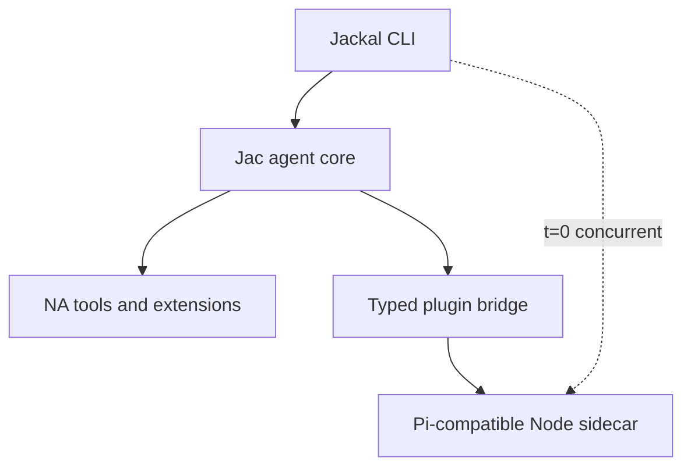

# Jackal Roadmap

**Updated:** 2026-11-04
**Product:** a fast native coding agent with a compatible JavaScript extension layer.

> **Positioning:** fx's form factor + Pi's ecosystem + Jac's codespace architecture. Jackal is a small native runtime with instant interactive startup; configured JavaScript extensions run in a concurrent Pi-compatible Node sidecar that must not block the first frame. See [`docs/NA-HARNESS-EXPLORATION.md`](docs/NA-HARNESS-EXPLORATION.md), [`docs/PLUGIN-HOST-PLAN.md`](docs/PLUGIN-HOST-PLAN.md), and [`docs/decisions.org`](docs/decisions.org).

---

## 0. Positioning

**A fast native coding agent with a compatible JavaScript extension layer.**
Or more aggressively: *native where performance matters, JavaScript where compatibility matters.*

The reference point is Vercel's [fx](https://github.com/vercel-labs/fx): a ~8 MiB native binary, effectively instant startup, minimal terminal interface, native/Wasm builds, ACP embedding, skills/MCP/subagents. fx validates the demand for native-minimal agents (~1.8K stars in three days). Jackal goes beyond it:

| Capability | fx | Jackal |
|---|---|---|
| Small native executable | Yes | Yes |
| Unix-like terminal UX | Yes | Yes |
| Native/Wasm portability | Yes | Yes, demonstrated through Jac |
| Embeddable agent core | Yes | Yes |
| Skills and MCP | Yes | Yes |
| Existing Pi extensions | No documented compatibility | **Yes** |
| Native extension path | Zig/core contribution | Jac `na` plugins |
| Mixed-runtime extension system | Limited | **Core architectural feature** |

Emulate fx's: restrained interaction, single executable, noninteractive mode, structured JSON output, ACP surface, ruthless startup-time and binary-size benchmarks. Do not imitate its branding or lead with "tiny" — tininess eventually conflicts with compatibility. The differentiator is the mixed-runtime extension story, which is also why codespaces exist.

Architecture rule: **JavaScript must not block the first frame** (parallel Node sidecar when extensions are configured). Absence of Node at boot is only an optimization for extension-free installs — not the product invariant for Pi users. See D21 and [`docs/PLUGIN-HOST-PLAN.md`](docs/PLUGIN-HOST-PLAN.md).



- When extensions are configured, Jac TUI/session and the Node host start **concurrently**; input is accepted at first frame; prompts may queue until the extension capability snapshot is ready.
- Measure **both** time-to-interactive and time-to-extension-ready.
- Communication crosses a stable typed event/tool API; fix async/multiplexed host I/O before Bun/QuickJS or a per-user daemon.
- Compatibility claims must match tiers: grow commands/events/hooks, or ship **Pi tool-extension compatibility** and report unsupported surfaces (no silent stubs as “full Pi”).
- Performance-sensitive extensions can migrate to Jac/NA (`runtime = "native"`) without a second plugin model.
- Do not embed Node/QuickJS in the native binary; a real Node sidecar (system or managed/pinned package) is the compat floor. Native executable stays small; total install need not be tiny if ecosystem compatibility is the differentiator.

## 1. Target product

Jackal must be good enough to replace Pi for daily Jac development. A line REPL is not the product.

The target experience includes:

- responsive streaming transcript
- editor-quality multiline input, history, paste, Unicode, and IME behavior
- visible tool timeline with cancellation and approvals
- diff review before destructive changes
- model, mode, session, and context status
- command palette, help, selectors, and overlays
- persistent sessions and reconnect/recovery behavior
- Jac toolchain and MCP integration
- skills, subagents, tasks, checkpoints, and compaction
- clean operation in common terminals, tmux, and SSH

## 2. Target architecture

```text
User terminal
    │
    ▼
app/tui/shell.jac LiveShell (native Jac TUI)
    │  typed events through the OSP UI framework (app/ui/)
    ▼
app/agent/session.jac session host
    ├─ owned ReAct loop + LLM transport
    ├─ tools, approvals, sessions, MCP
    ├─ Cordis composition core (app/cordis/)
    └─ natively pinned kernels (app/core/*)
```

### Ownership

| Concern | Owner |
|---|---|
| Session, turn, model, tool, approval, persistence truth | `app/agent/` brain |
| Focus, layout, selection, scroll, animation, theme | `app/ui/` renderer |
| Transport framing | term REPL / JSONL / in-process TUI queue |
| Pure measured hot paths | natively pinned modules (`app/core/`) |

### UI framework model

Jackal implements a compact framework modeled on Pi's differential TUI:

```text
render(width) -> list[str]
handle_input(data)
invalidate()
```

Components render width-bounded ANSI lines. The framework composes focus and overlays, compares the frame with the previous frame, and emits one synchronized ANSI update for the changed range.

The component structure and reactive invalidation backend is OSP-native: data-only `UiNode` values use ordered typed `Child` edges, source signals use `Feeds` edges, and process-local render/input closures live outside graph nodes. A thin projection implements `render(width)`, `handleInput(data)`, and `invalidate()`. OSP owns structure and lifecycle; cached flat `list[str]` frames and ANSI comparison remain the renderer hot path.

The TUI targets the native codespace end to end; terminal support comes from `na_stdlib` floors (`termios`, `select`, `fcntl`, …), not server Jac. C is not required for rendering. Narrow C FFI or native kernels are permitted only for a platform gap or measured performance need.

## 3. Binding decisions

1. **All new product work lands in `app/`. The all-Jac harness IS Jackal.**
2. **`src/`, `lib/jac/`, `templates/`, `tui/*.tsx`, `tui/pi_jac/`, and `tui/pi_jac_floor/` are deleted;** `tui/js2jac/` remains an active conversion workstream.
3. **The line REPL is a debug adapter**, not a milestone UX (`app/main.jac` term mode).
4. **MCP uses `jac mcp` as a subprocess**; an in-process rewrite needs profiling evidence.
5. **Zero server-codespace product code.** The `server` tier is a contingency, not an architecture: every module in `app/` must eventually compile and execute native (see §N6). Server pins are temporary scaffolding, each annotated with its unblock condition; `default_codespace = "native"` in `app/jac.toml`.
6. **Small native executable; honest total install.** Keep the first frame free of JS work. Do not embed a Node runtime in the shipped binary; run a concurrent Pi-compatible Node sidecar when extensions are configured (D21). Managed Node packaging is allowed — total install need not be tiny.
7. **Cordis is the composition model**, but product usability precedes dynamic loading and self-evolution.

## 4. Current state

### Landed

- [~] All-Jac application root under `app/`, compiled natively by default (`default_codespace = "native"`); the app tree type-checks, but native coverage still reports the documented UI and stdlib demotions
- [x] Owned ReAct loop (`app/agent/session.jac`) with streaming transport, turn abort, and worker-thread execution off the TUI loop
- [x] Tool surface: read/write/edit/bash/web tools plus edit/diff kernel natively pinned (`app/core/edit.jac`)
- [x] OSP differential-TUI framework complete (`app/ui/`): terminal + virtual terminal, input normalization, renderer/screen/transcript/editor, layout engine over `app/constraints/` solver, markup/markdown projection, focus, overlays, keybinding probe
- [x] Live shell (`app/tui/shell.jac`) wired to the real agent: transcript, editor, autocomplete popup, `/model` picker, `/tasks`, `/checkpoints` + named checkpoints, `/explorer` multi-select @file injection, `/skills` + inline `/skill:` expansion, session list/resume/export/save, extension commands and extension UI modals, approval overlay
- [x] Sessions persisted under `.jackal/sessions/` (JSON transcripts + index sidecar)
- [x] fx-style provider-first model routing with selection-time auth validation (`app/agent/llm.jac`)
- [x] Auth store + login flow state machine ported (`app/agent/auth.jac`; auth.json byte-compatible with legacy pi-ai shape)
- [x] MCP subprocess client (`app/agent/mcp.jac`) wired into the session registry (`mcp_<server>_<tool>` naming)
- [x] Plugin host P0–P5: session-owned bridge, parallel Node sidecar, dual clocks, async/corr/cancel, T1 caps, Node resolve path (`app/plugin_host/`); P6 absorb / P7 daemon deferred until measured — [`docs/PLUGIN-HOST-PLAN.md`](docs/PLUGIN-HOST-PLAN.md)
- [x] Cordis C0 composition core (`app/cordis/core.jac`)
- [x] Test suites lowering natively suite-by-suite (~55 `.test.jac` files across `app/`; counts approximate)

### Known gaps

- [x] Auth UI wired into the live shell as `/login` (API-key providers; OAuth reports the native runtime limitation honestly)
- [x] Native in-shell mode cycling and approval policy (normal/auto-accept/yolo/plan/ask)
- [x] Native `--mode` / `JACKAL_MODE` consumption and mode-specific prompt appendices
- [x] Native `jid()` builtin lowering and object identity formatting
- [~] Packaging, install, upgrade, and recovery story for the native path is not settled
- [~] Session-data migration policy vs legacy runtime data is explicit backup/incompatibility work, not an implicit conversion
- [~] MCP integration breadth (status surfacing in the TUI, failure degradation UX) unverified
- [x] Headless native term/JSONL launch (`jac run main.jac` / `main.jac -- --json`); broader CLI parity remains pending
### Current native frontier

`app/jac.toml` currently contains 29 explicit server pins (18 TUI, 7 UI, 4
agent, and `ui.emulated_terminal`). The latest local seal snapshot reports 147
entries: 8 native-only, 138 server-only, and 1 dual-placed. It is tagged
`cpython-314`, so the current artifact does not meet the target. A source pin
and native-unit lowering do not prove that the product import path executes
natively: the sealed placement graph is the evidence to use. The supported
product roots are `main.jac` (line/JSONL/print modes) and `tui/shell.jac`;
`run.jac`, `tui/harness.jac`, `e2e/`, and test annexes are development or test
roots and must not inflate the product closure. The product must run with no
CPython runtime or Python package dependencies. Chat streaming now has a
Jac-native socket/TLS/SSE implementation, but its importer graph is still
server-placed. `pyte` and Python-only host APIs remain open seams. Native
threading primitives and the typed TUI message queue have now been added; the
thread compatibility and product-root integration probes remain open.


## 5. Delivery phases

### N0 — Harness vertical slice — **done**

Owned ReAct loop, streaming transport, core file/shell tools, term and JSONL adapters, native edit-kernel call from server code. Acceptance met: multi-turn inspect-and-edit sessions with streamed tool/model events.

### N1 — Jac TUI foundation — **done**

Terminal interface (process + virtual), raw mode/input buffering/key normalization, component model with invalidation, width-bounded rendering, focus and overlay stack, differential renderer, UI event loop separated from agent execution, typed envelopes. Acceptance met: flicker-free sustained streaming, resize/paste/cancellation/restoration covered by virtual-terminal tests (`app/ui/n1_acceptance.jac`).

### N2 — Daily-driver core — **largely landed on the native path**

Landed: transcript/markdown/tool timeline/status, editor autocomplete, session persistence/resume/rename/export, turn abort and cooperative cancellation, in-shell mode cycling and approval policy, approval overlay with structured diffs, MCP subprocess clients, plugin host control plane (D21, P0–P5), `/login`, and native CLI mode selection.

Remaining for N2 closure: auth OAuth/browser continuation, MCP status/failure UX, bounded-queue/coalescing polish (verify against `app/tui/shell.jac` before claiming any item done). N6 native placement remains a separate compiler/runtime workstream.

### N3 — Legacy deletion + packaging — **deletion landed**

- Packaging, install, upgrade, and recovery documentation
- Explicit session-data migration/incompatibility policy for legacy `.jackal/sessions/` data
- No daily workflow may require the deleted trees

Acceptance: default `jackal` launch uses `app/`; native launcher smoke checks pass with the legacy trees gone. Full `app/` native closure remains N6 work.

### N4 — Composition and extensibility integration

**Goal:** integrate the landed Cordis model into stable product interfaces. Cordis research and reversible prototypes may proceed earlier, but must not block N1–N3 or make unstable UI/session interfaces permanent.

Deliverables:

- componentize tool suites, renderer, transport, and session host as fibers
- derive active tools from live `tools.*` provisions
- `.jackal/components.toml` loader and reconciliation
- recovery tests proving unload restores context
- hot swap with state preservation
- optional agent-managed component deployment behind approvals

Acceptance:

- unloading a tool suite removes it from the next turn and reverts its effects
- swapping a renderer does not lose the session
- configuration changes reconcile to quiescence without restart
- `dispose_all` restores an empty composition context

See [`docs/CORDIS-DESIGN.md`](docs/CORDIS-DESIGN.md).

### N5 — Profiled kernels and optional surfaces

**Goal:** optimize only measured bottlenecks and add non-terminal adapters only after terminal parity.

Candidates:

- diff/edit
- ANSI width and wrapping
- frame comparison/composition
- token estimation
- markdown block parsing

Optional surfaces:

- Jac Desktop/web renderer over the same typed session interface
- remote/daemon transport if live reattachment becomes a requirement
- in-process MCP only if subprocess overhead is material

Acceptance:

- every new native pin has an end-to-end benchmark and regression test
- no optimization moves session or policy truth out of the brain
- optional renderers consume the same command/event interface

## 6. Workstreams

### TUI quality

- terminal lifecycle and restoration
- input correctness across terminal protocols
- virtual-terminal and PTY test harness
- editor, transcript, markdown, overlays, and diff UI
- cached rendering and bounded frame rate

### Agent parity

- safety modes and permissions on the native path
- MCP breadth and status UX
- compaction, subagents, chains depth
- plugin host: P0–P5 landed; P6 absorb / P7 daemon only after metrics — see [`docs/PLUGIN-HOST-PLAN.md`](docs/PLUGIN-HOST-PLAN.md) §14

### Composition

- Cordis component interfaces
- loader and recovery semantics
- hot swap and later self-evolution
- absorb hot JS extensions into Jac/NA over time (`runtime=native`)

### Native kernels

- benchmark first
- pin narrowly
- keep server/native crossings coarse and batched

## 7. Legacy policy

| Path | Policy |
|---|---|
| `src/` | Absent; deletion target already removed |
| `lib/jac/` + `templates/` + `tui/*.tsx` + `tui/pi_jac/` + `tui/pi_jac_floor/` | LEGACY-PENDING-REMOVAL; frozen deletion targets |
| `tui/js2jac/` | Active conversion workstream (own sync contract, `SYNC.md`) — not legacy |
| `pi/` | Config/data bundle consumed by the native harness |
| `app/core/` | Natively pinned kernels with benchmark gates |

Do not mix unrelated legacy edits into `app/` feature commits.

## 8. Non-goals

- A line-oriented product interface
- Restoring the removed Jac plugin system or the TypeScript runtime
- A broad C FFI terminal layer
- A single executable containing HTTP, model providers, MCP, and the TUI
- Full IDE/LSP replacement
- Desktop UI before terminal daily-driver parity

### N6 — Native-only product runtime — active

**Goal:** Jackal’s product and app-test execution do not require CPython,
Python bytecode, Python packages, or server-codespace modules. Every product
module and every app test/helper executes in native codespace. The `server`
tier remains a compiler-only fallback, never part of Jackal runtime or test
execution. The Jac compiler/toolchain used to build the native artifact is a
separate host tool.

**Current state:** `app/jac.toml` has 29 explicit `"server"` pins: 7 UI
entries (including the test-only emulated terminal), 4 agent, and 18 TUI. The
latest local seal has 147 entries (8 native-only, 138 server-only, 1
dual-placed) and is tagged `cpython-314`. The product still has server
placements throughout the UI/TUI and agent dependency graphs. Chat streaming
no longer depends on `httpx`; its socket/TLS/SSE implementation is present,
while product call-path placement is still open. Product call sites import
`threading`; native worker, lock, and event support is now implemented in the
vendored Jac runtime, and the TUI stream/command queue is a typed Jac module.
The first native worker, event, and queue handoff probe passed on macOS.
Remaining thread call sites that pass `args=` still need to move to typed
zero-argument closures or be supported by the native API. Native Jac
implementations exist for `urllib`, `subprocess`, and `tempfile.mkdtemp`;
native placement and full behavior still need root-level proof. `pyte` remains
test-only. A successful `.jab` build alone does not establish native
execution or a Python-free runtime.

**Latest native probe:** the grouped TUI-root probe with server pins
temporarily promoted now gets past the former `queue` and
`sys.stdin.isatty` walls. `tui.message_queue` is a typed Jac queue backed by a
native lock, and the TUI checks terminal descriptors with `os.isatty`. The
probe proceeds into the imported session/UI graph and still demotes at
`agent.session`, model and mode accessors, auth hydration, rendering, input,
and resize functions. A separate `main.jac --native --lib` probe confirms the
headless product root also stops at its `agent.session` import. The native
`threading` floor provides worker, lock, and event primitives implemented
through native POSIX threads; a macOS compiled probe passed a captured Jac
closure, event handoff, and typed TUI queue operation. MCP and plugin-host
reader launches now capture their clients in zero-argument closures. The
native MCP product functions now all lower in the library build: typed waiter
and thread state replaces `any`, stdio uses native subprocess descriptors,
and native environment enumeration preserves inherited variables when
applying `env_extra`. Native `urllib.error` types are present, and MCP no
longer passes Python-only `bufsize` to `Popen`. Native
`urllib.request.urlopen(timeout=...)`, response headers/line reads, and socket
timeout declarations compile through the MCP import graph. The merged MCP
test annex still demotes Python fake-server fixtures; this is test support,
not evidence that the product functions execute natively.
The native `subprocess`
floor now has Linux and Darwin variants (vendored commit `221918f8`). A macOS
arm64 native executable probe successfully spawned `/usr/bin/true` and captured
`/bin/echo` output through a pipe. This validates basic Darwin spawn/wait and
capture, not the full timeout, cwd, env, or kill surface. Jackal needs it for
shell tools, MCP,
and the Node sidecar. Remaining Jac native-runtime gaps are tracked upstream
in
[jac#10585](https://github.com/jaseci-labs/jac/issues/10585).
The separate `main.jac --native --lib` probe now stops at `E5090` on
`agent.session`, which is explicitly server-pinned. Its merged
`main.test.jac` annex no longer fails to resolve `tempfile`: vendored
`tempfile.mkdtemp` now builds and runs in a native arm64 macOS executable.
This confirms entry-root probes include test annex code; the placement ledger
must report product and test closures separately, while the no-Python audit
must still account for the test closure.

**Acceptance criteria:** (1) zero `"server"` placements in product roots and
zero Python-backed app test/helper modules; (2) a clean install/run of the
sealed artifact and app test runner succeeds with CPython unavailable and no
Python package installation; (3) native execution evidence proves the placed
native payload is used, not just present alongside Python bytecode. Build
success alone does not prove criteria 2–3.

**Seam scope and order:**

The target is no CPython in Jackal's product or app test runtime. Python may
remain a development tool used to build/debug the Jac compiler, but it is not
an acceptable host for app modules, native services, test execution, or the
sealed launcher. Keep Python-shaped imports only as temporary compatibility
edges while replacing them with Jac APIs/native floors; a server pin or Python
adapter does not close a seam.

| # | Seam | Concrete scope / current boundary | Exit evidence |
|---|---|---|---|
| 0 | Product/test graph and placement ledger | Trace `main.jac`, `tui/shell.jac`, and every `*.test.jac` closure separately. Same-stem test annexes are merged into build units, so classify their imports explicitly. The artifact currently includes `agent/sse_test_server.py`; `app/e2e/fixtures/*.py` and `ui.emulated_terminal` are also Python-backed test support. Native `tempfile.mkdtemp` resolves one prior missing-import wall, but does not close these Python edges. | Per-root manifest reports product and test closures separately; neither closure contains Python modules, Python packages, or server placements. |
| 1 | Jac/native runtime and test-runner contract | `jac test` currently executes pre-seal in server codespace and ignores placement pins. Define native test dispatch and audit the artifact runner, test runner, manifest, imports, and transitive native runtime. Keep the Jac compiler/toolchain as a separate host tool. | Clean artifact and app tests run with CPython and Python packages unavailable; loader trace shows no Python runtime load. |
| 2 | OS and standard-library floors | Provide native APIs for filesystem/path/env, JSON, time/random/UUID, Unicode/stream decoding, HTTP(S)/TLS, cross-platform child processes, and worker/channel/lock/event lifecycle. Native `threading` plus typed Jac `tui.message_queue` pass a macOS compiled handoff probe; MCP and plugin-host workers use closure targets. All MCP product functions now lower in its native library build using native subprocess descriptors, typed waiters, and native environment enumeration. The merged MCP test annex still contains Python fake servers. Web tools need Jac URL parsing and IP classification or native equivalents; merged web-tools tests currently use socket-server APIs missing from the native socket floor. Replace Python test servers with native Jac fixtures, then validate cancellation, lock contention, redirect/SSRF behavior, and Linux behavior. Preserve MCP and Node sidecar as OS-process capabilities. | Product and test imports resolve only to Jac modules or documented native floors; representative floor calls execute with no Python interpreter on macOS and Linux. |
| 3 | UI / OSP object graph | Move the product graph rooted at `ui.runtime*`, `ui.model`/`mutation`, `ui.events`, `ui.screen`, `ui.input`, renderer, and transcript together. Resolve cross-module object construction/layout, `jid()` identity, walker dispatch/protection, bound-edge references, unary expressions, callable fields, and event/session boundaries. `ui.gates` and `ui.inspect` are validation/debug consumers unless entry-point tracing proves otherwise. | Shell construction, event handling, mutation, render, and disposal all execute in native placement. |
| 4 | TUI loop and terminal | Lower the product modules imported by `tui.shell` (currently 18 explicit TUI pins) after the UI graph. The `queue` and TTY-detection walls are cleared; now lower the shell dependencies on `agent.session`, `ui.runtime`/`screen`, renderer, input, resize, and TUI composition modules. Keep the in-process worker/channel contract native through streamed output and approval. | TUI starts from a clean artifact and handles streamed output, approval, cancellation, resize, and terminal restoration natively. |
| 5 | Agent and integration graph | `agent.extensions` now lowers and seals native. `agent.registry` builds as a native library after typing a test annex value; verify function-level placement and remove its remaining logging/bridge dynamic boundaries. The first agent root wall is `agent.session`; advancing MCP now exposes missing native `urlopen(timeout=...)`; advancing plugin bridge I/O exposes server-placed `agent.protocol` envelope construction. A grouped native probe also demotes model setters/getters through session configuration hooks and hits an E9003 callable ABI ICE in the merged `sessions.test.jac` annex (reported on jac#10542). Then lower session composition and the plugin bridge; resolve auth/config/session JSON and paths, provider streaming, web fetch, MCP stdio/HTTP, and sidecar process/channel lifecycle. | Authenticated mocked tool turn plus MCP and configured-extension lifecycle run in native placement. |
| 6 | Python-backed test/support removal | Port `agent/sse_test_server.py` and `app/e2e/fixtures/*.py` to Jac/native fixtures; remove `pyte` through the Jac `VirtualTerminal` or a native emulator. Move same-stem test-only imports/helpers out of product modules where annex merging pollutes product lowering. Convert the app test runner from server dispatch to native execution. | Every app test and fixture is Jac/native and can execute without CPython or Python packages. |
| 7 | Artifact proof and pin retirement | Build clean artifacts for both product roots and the native app test runner; remove temporary pins only as each boundary closes. Keep validation/debug-only modules out of product closure only after import tracing confirms they are unreachable. | Product and test closures run with zero server placements, no CPython/Python-package dependency, and recorded native execution evidence. |

Compiler bugs discovered en route are logged in the local native-lowering notes;
fixes land in `vendor/jac/**` and are reported upstream. Native lowering work must
preserve the no-Python runtime acceptance: moving a product seam into Python or
mirroring native types into Python does not close an item.

### Concrete seam inventory

The 29 server pins split into 7 UI modules (including the test-only
emulated-terminal adapter), 4 agent modules, and 18 TUI modules. The server
list is not itself the product frontier: first classify each pin by whether
`main.jac` or `tui/shell.jac` reaches it. Gates, inspect, demos, and harnesses
may be dev/test-only; `ui.input`, `ui.screen`, agent session services, and the
TUI loop are product paths.

| Boundary | Current app surface | Work to close |
|---|---|---|
| Native OS services | Native `threading` is used by `tui.runtime`, `tui.commands`, `agent.interactions`, `agent.session_config`, `agent.mcp`, `agent.web_tools`, and `agent.plugin_bridge_io`; `tui.message_queue` owns the typed TUI channel. MCP and plugin-host workers use closure targets. MCP product functions now lower in the native library build with typed process/event/waiter state and native subprocess descriptors/environment enumeration; its merged annex still imports Python HTTP-server/process fixtures. Web tools additionally imports unavailable `urllib.parse`; its merged test annex expects server socket methods that do not exist in native `socket`. `subprocess` serves tools, checkpoints, context input, MCP, plugin host, and launcher. Replace web URL parsing and IP checks with Jac/native code; port native HTTP/socket fixtures; then prove cancellation, lock contention, redirect/SSRF behavior, and Linux behavior. Darwin subprocess passes basic spawn/wait and captured-output probes; exercise timeout, cwd, env, and kill before closing the full floor. The optional `run.jac` launcher probe independently hits `os.access`, `dict(os.environ)`, and unresolved `returncode` lowering walls. |
| UI object and compiler graph | Product UI roots still reach `ui.screen` and `ui.input`, with known native blockers in cross-module object layouts, `jid()` identity, bound endpoints, unary expressions, callback fields, walker dispatch, and session/event crossings. The demo graph, gates, inspect, and emulated terminal must be classified separately from product reachability. | Resolve compiler/runtime walls in vendor Jac with minimal repros and upstream issue links. Promote screen/input only after native build and execution probes; keep root-reachable consumers in the same native graph. |
| Agent graph | Product roots reach `agent.session`; `protocol`, `registry`, and `plugin_bridge` are additional server pins whose exact reachability must be recorded per root. `agent.extensions` seals native. Registry's latest library compile succeeds, but dynamic bridge dispatch, exception logging, and function-level placement still need closure evidence. Plugin bridge I/O still passes `any` bridge state, and its envelope factory currently crosses into server-placed `agent.protocol`. | Define typed native host capabilities and factories. Close registry invocation, promote protocol data/factories into the native graph, then lower session composition and plugin I/O; keep the Node sidecar as a child process behind a native Jac protocol boundary. |
| Test/runtime contamination | `jac test` ignores placement pins and runs suites in server codespace. `agent/sse_test_server.py` and `app/e2e/fixtures/*.py` are Python files in the app tree; `ui.emulated_terminal` imports `pyte`. Same-stem annexes also import test-only helpers into product units. | Add native Jac test dispatch; port test servers/fixtures and replace `pyte`; split or otherwise isolate test-only helpers from product lowering. Do not count a test as native because its `.jac` source compiled into an artifact. |
| Artifact and launch | The latest app build seals 147 modules with a `cpython-314` tag and 138 server-only placements. A native payload is present, but the launcher still requires the Python-tagged runtime and a native payload present in the artifact does not prove it handled execution. | Seal product roots independently of test annexes, then run the artifact with CPython and Python packages unavailable. Capture loader/runtime evidence that the native payload handled launch and verify no server placements remain. |

Recommended order: (1) generate the root/test closure ledger and isolate annex
imports; (2) finish native thread call compatibility and floor coverage; (3)
close the headless `main.jac` vertical slice beginning with `agent.session`,
registry invocation, and provider/tools; (4) close the shared UI object/compiler
graph, then the TUI loop and terminal; (5) port Python-backed fixtures and
replace `pyte`, then move `jac test` execution to native; (6) seal product roots
and tests separately and prove both run without CPython.
Verify each slice at the importing root so a native leaf is not mistaken for a
closed product or test path.

## 9. Immediate next milestone

Advance N6 in dependency order. Native threading, the typed TUI queue, and
native TTY detection are underway. The current product-root blockers are
`agent.session` for the headless entry and its agent composition, then the
shared UI/OSP and TUI graph. Maintain a generated closure ledger alongside
these implementation slices:

```text
main.jac / tui/shell.jac / *.test.jac import-closure ledger
        ↓
finish native worker call sites + channel + lock + event + cancellation proof
        ↓
headless main.jac vertical slice (session → registry → provider/tools)
        ↓
native UI/OSP graph → TUI loop and terminal
        ↓
native app-test dispatch + Jac test servers/fixtures + removal of pyte
        ↓
separate product/test seals; run with CPython and Python packages unavailable
```

Auth UI, packaging, session-data policy, and the legacy-tree deletion remain
product milestones, but they do not close N6 and should not be used as evidence
for native runtime completion. N6 is complete only when the headless and TUI
product roots plus app tests execute from native placements with CPython and
Python packages unavailable.


## 10. Related documents

| Document | Role |
|---|---|
| [`AGENTS.md`](AGENTS.md) | Repository rules and architecture map |
| [`docs/NA-HARNESS-EXPLORATION.md`](docs/NA-HARNESS-EXPLORATION.md) | Codespace and UI decision record |
| [`docs/CORDIS-DESIGN.md`](docs/CORDIS-DESIGN.md) | Dynamic composition design |
| [`docs/PLUGIN-HOST-PLAN.md`](docs/PLUGIN-HOST-PLAN.md) | Parallel Node sidecar; JS must not block first frame (D11/D13/D21); §14 lessons from P0–P5 |
| [`docs/VENDOR-JAC.md`](docs/VENDOR-JAC.md) | Vendored Jac compiler subtree rules |
| [`docs/decisions.org`](docs/decisions.org) | Architecture decision log |
